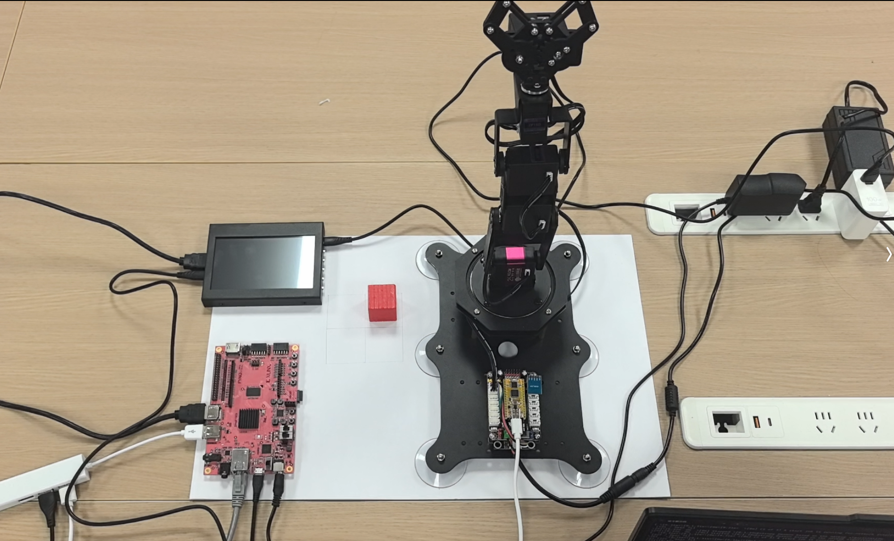
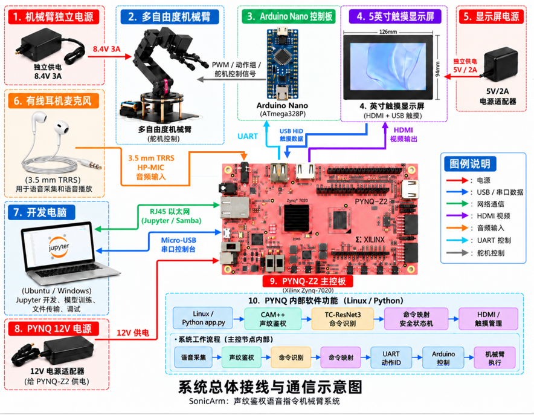
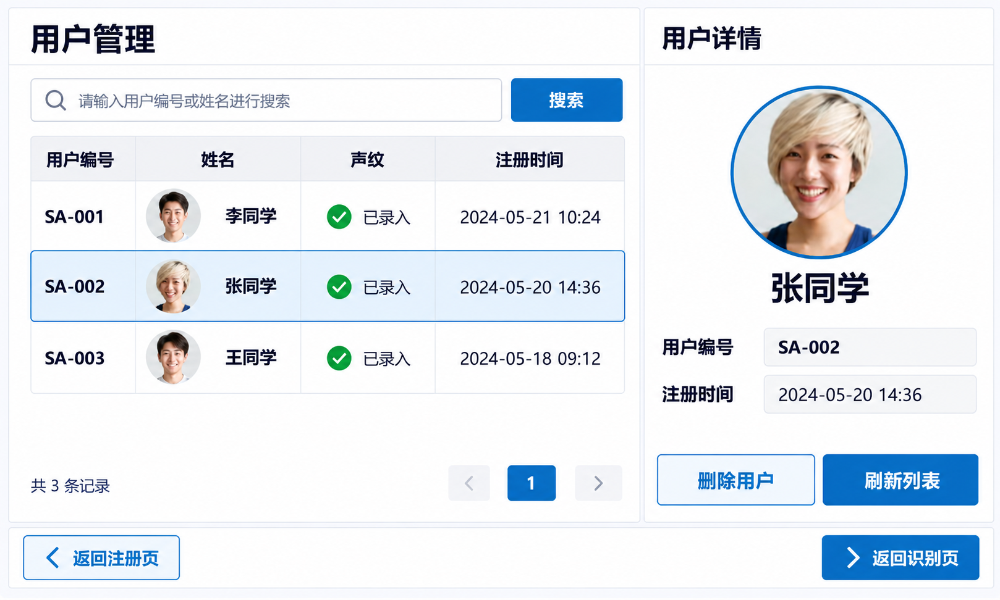

# SonicArm

SonicArm 是面向 PYNQ-Z2（Zynq-7020）的声纹鉴权、短语识别与机械臂控制系统。FPGA-10 单 Overlay 负责音频、CAM++ 加速和 HDMI/VDMA 显示；PS 端运行 TC-ResNet3、触控界面和安全状态机，并通过 USB-UART 与机械臂控制板通信。

本项目源码采用 [Apache License 2.0](LICENSE) 开源，可在遵守许可证条款的前提下使用、修改和再分发。

<p align="center">
  
</p>

<p align="center"><em>PYNQ-Z2、触控显示屏、六自由度机械臂与独立供电组成的 SonicArm 实物系统</em></p>

## 当前正式配置

- 器件：PYNQ-Z2 / `xc7z020clg400-1`
- PL 时钟：100 MHz
- 开发工具：Vivado 2025.2 / Vitis 2025.2
- 语音窗口：3.0 s，16 kHz 单声道
- 短语模型：TC-ResNet3 `Jingyuan_v5_20261026`
- 声纹阈值：0.67
- 指令执行阈值：0.85
- 机械臂、上电自动复位和语音复位：启用

本项目的 FPGA 工程创建、HLS 开发与综合、Vivado 综合、布局布线、静态时序分析及 bitstream 生成均以 **Vivado / Vitis 2025.2** 为基准。使用其他版本时，应重新生成 IP、执行完整构建并复核时序、资源和 bit/HWH 匹配关系。

## 关键结果

| 项目 | 结果 | 证据入口 |
| --- | ---: | --- |
| FPGA-10 布局布线后时序 | WNS +0.324 ns，TNS 0 ns | `build/reports/impl_timing_summary.rpt` |
| FPGA-10 资源占用 | LUT 49.34%，FF 29.11%，BRAM 62.86%，DSP 50.45% | `build/reports/impl_utilization.rpt` |
| 声纹模型评测 | EER 4.8719%，minDCF 0.3223 | `src/models/voiceprint/runtime_bundle/legacy/evaluation/` |
| 短语识别回归 | 真人录音 148/149（99.33%），板端录音 25/26（96.15%） | `src/models/kws/tc_resnet3/training/README.md` |

完整系统设计、实现过程和测试说明见 [SonicArm 技术文档](report/sonicarm_technical_report.pdf)；从全新环境开始的依赖安装、回归测试、FPGA 重建、板端打包、网络配置、部署启动和功能验收见 [SonicArm 从零复现指南](report/reproduction_guide.md)。仓库内可核验报告集中在 `report/`。

工程提交的统一验收入口见 [最终板端验收索引](report/validation/final_board_acceptance.md)，其中汇总了干净构建、时序/资源、BIT/HWH 哈希、既有板端记录和现场验收顺序。

## 自建语音数据集

完整的训练、验证、历史来源与板端测试音频未直接放入源码仓库，可通过百度网盘获取：

- 数据集名称：`自建语音数据集全集`
- 下载链接：[https://pan.baidu.com/s/1MD6Nicn7966mtpEHUPKLDA?pwd=a63x](https://pan.baidu.com/s/1MD6Nicn7966mtpEHUPKLDA?pwd=a63x)
- 提取码：`a63x`

下载后请保持数据集内部目录结构；数据来源、划分及文件校验信息以数据集内的 README、manifest 和 SHA-256 清单为准。数据集仅用于本项目的训练与复现实验，使用者仍应遵守其中标注的数据授权、隐私和再分发条件。

## AI 协作与技能包

- [大模型协作过程报告](report/ai_collaboration_report.md)：记录代表性提示词、模型回答、失败修正、自我纠错轨迹及对应工程产物。
- [`skill/`](skill/)：从项目开发中提炼的 PYNQ Overlay 审计、IP 驱动、数据通路和证据验证技能包。
- [`skill/docs/`](skill/docs/)：技能包的开发过程、竞赛要求映射、历史访问范围和验证状态。

报告中的大模型建议不单独作为功能、性能或硬件验收证据；最终结论以源码、测试、Vivado/Vitis 报告及板端记录为准。

## 仓库结构

```text
SonicArm/
|-- README.md                 项目简介与复现入口
|-- src/                      PS 软件、模型运行时和自定义 IP 源码
|   |-- ps/                   当前 FPGA-10 板端正式应用
|   |-- models/               CAM++、TC-ResNet3 v5、兼容运行时及v2/v3/v4历史模型
|   `-- ip/                   HLS/Vivado 自定义 IP
|-- sim/                      离线单元测试、集成测试和 Notebook
|-- build/                    Tcl/XDC、构建脚本和打包脚本
|-- board/                    板端产物、诊断程序与手动部署脚本
|-- data/                     公开评估摘要与精简历史代码归档
|-- skill/                    外部技能交付说明
`-- report/                   架构、接线、验证证据和开发记录
```

正式工程入口采用英文目录名和文件名；`data/archive/` 保存各代核心源码与说明，用于展示从单算子到完整系统的真实迭代。

## 系统数据流

<p align="center">
  
</p>

```text
耳麦 -> FPGA 音频采集 -> CAM++ 声纹鉴权 -> TC-ResNet3 指令识别
     -> 身份/指令/状态机门控 -> USB-UART -> 控制板 -> 六自由度机械臂

同一进程：HDMI/VDMA 原生界面 + USB-HID 触摸 + Web 调试镜像
```

## 交互界面

<table>
  <tr>
    <td align="center" width="50%">
      <br>
      <sub><b>身份与命令识别</b>：显示声纹匹配度、识别指令和机械臂运动状态</sub>
    </td>
    <td align="center" width="50%">
      <br>
      <sub><b>声纹注册</b>：录入用户信息并完成三段声纹样本采集</sub>
    </td>
  </tr>
</table>

<p align="center">
  <br>
  <sub><b>用户管理</b>：支持用户检索、声纹状态查看、详情展示和用户管理</sub>
</p>

三套页面共同覆盖用户注册、身份鉴权、语音指令识别、机械臂状态显示与用户管理流程。

## 离线测试

```powershell
powershell.exe -NoProfile -ExecutionPolicy Bypass -File .\sim\run_tests.ps1
```

当前基线为 28 项离线测试。离线通过不等同于声纹阈值校准、机械臂安全签核或板端整机验收。

## 生成板端目录

```powershell
powershell.exe -NoProfile -ExecutionPolicy Bypass -File .\build\scripts\build_board_package.ps1
```

输出到 `board/generated/fpga_10_<timestamp>/`。本提交包已在 `board/artifacts/` 保留正式 BIT/HWH 配对，并使用 `board/artifacts/SHA256.json` 校验；公开仓库也可将大体积产物改放 GitHub/Gitee Release，但必须保持哈希和配对关系。

## 板端启动

```bash
cd /home/xilinx/jupyter_notebooks/SonicArm/test_1/fpga_10
/usr/local/share/pynq-venv/bin/python3 -u app.py --host 0.0.0.0 --port 8080
```


