# SonicArm FPGA-10 系统数据流图

```mermaid
flowchart LR
    %% ========= External devices =========
    MIC["有线耳麦\n模拟麦克风"]
    SCREEN["5英寸触控屏\nHDMI显示 + USB触摸"]
    ARM["六自由度机械臂\n舵机与机械结构"]

    %% ========= PYNQ-Z2 =========
    subgraph PYNQ["PYNQ-Z2 / Zynq-7020"]
        direction LR

        subgraph PS["PS：ARM Cortex-A9 + PYNQ Linux"]
            direction TB
            APP["app.py\n单进程启动与资源所有权"]
            UI["native_display.py / ui/server.py\n触摸交互、注册、识别与状态显示"]
            CTRL["controller.py\n任务编排、用户模板和运行记录"]
            AUDIO["board_runtime.py + v9_audio.py\n48 kHz采集、质量门控、选通道、16 kHz重采样"]
            CAMPS["CAM++ PS运行时\nFbank、未加速层、192维嵌入与L2归一化"]
            PROFILE[("用户声纹模板\nprofile.npy / profile.json")]
            KWS["TC-ResNet3 PS推理\n15类短语、置信度"]
            DECIDE["v9_core.py\n身份阈值 + 命令阈值 + 拒绝标签"]
            STATE["arm_integration.py\nArmDispatcher安全状态机"]
            SERIAL["verified_arm_control.py\nUSB-UART串口后端"]

            APP --> UI
            APP --> CTRL
            CTRL --> AUDIO
            AUDIO -->|"同一段16 kHz语音"| CAMPS
            AUDIO -->|"同一段16 kHz语音"| KWS
            CAMPS -->|"声纹嵌入"| CTRL
            PROFILE <-->|"余弦相似度/注册模板"| CTRL
            CTRL -->|"相似度、身份"| DECIDE
            KWS -->|"类别、置信度"| DECIDE
            DECIDE -->|"允许的规范化命令"| STATE
            STATE -->|"单飞行动作"| SERIAL
            CTRL -->|"阶段、结果、故障"| UI
        end

        DDR[("共享 DDR\n特征、权重、中间张量、帧缓冲")]

        subgraph PL["PL：FPGA-10 单 Overlay / 100 MHz计算域"]
            direction TB
            OVL["匹配的 bit + HWH\nOverlay加载与地址映射"]
            CODEC["Audio Codec Controller\nADAU1761控制与PCM搬运"]
            CAMPL["CAM++统一加速IP\nPointwise / FCM等卷积计算"]
            VIDEO["HDMI显示通路\nVDMA + Video Out + RGB2DVI"]
        end

        APP -.->|"加载一次、初始化一次"| OVL
        OVL -.-> CODEC
        OVL -.-> CAMPL
        OVL -.-> VIDEO

        CODEC -->|"PCM音频"| AUDIO
        CAMPS -.->|"AXI4-Lite：寄存器/启动/状态"| CAMPL
        CAMPS -->|"HP AXI：输入与参数"| DDR
        DDR -->|"共享缓冲区"| CAMPL
        CAMPL -->|"加速结果"| DDR
        DDR -->|"回读中间张量"| CAMPS
        UI -->|"绘制帧"| DDR
        DDR -->|"VDMA帧读取"| VIDEO
    end

    %% ========= External links =========
    MIC -->|"HP/Mic模拟输入"| CODEC
    VIDEO -->|"HDMI OUT"| SCREEN
    SCREEN -->|"USB HID触摸事件"| UI
    SERIAL -->|"/dev/ttyUSB0\串行命令"| MCU["Arduino控制板\n已验证动作固件"]
    MCU -->|"动作序列/舵机控制"| ARM
    STATE -.->|"完成、拒绝或FAULT状态"| UI

    %% ========= Styles =========
    classDef ext fill:#fff7e8,stroke:#d99b3d,stroke-width:2px,color:#17354b;
    classDef ps fill:#eef7fc,stroke:#4d9fc5,stroke-width:2px,color:#17354b;
    classDef pl fill:#edf9f7,stroke:#2c9c91,stroke-width:2px,color:#17354b;
    classDef safe fill:#fff0f0,stroke:#cf6f6f,stroke-width:2px,color:#17354b;
    classDef mem fill:#f5f1fb,stroke:#937ac3,stroke-width:2px,color:#17354b;
    class MIC,SCREEN,ARM,MCU ext;
    class APP,UI,CTRL,AUDIO,CAMPS,PROFILE,KWS,SERIAL ps;
    class OVL,CODEC,CAMPL,VIDEO pl;
    class DECIDE,STATE safe;
    class DDR mem;
```

## 图例与报告表述

- 实线：音频、特征、张量、识别结果或动作命令等数据流。
- 虚线：Overlay配置、寄存器控制或状态反馈。
- TC-ResNet3运行在PS；不要画成PL加速模块。
- CAM++是混合执行：PS负责前后处理和未加速部分，PL负责统一卷积加速IP。
- DDR是PS与PL共享的数据交换中心；控制面使用AXI4-Lite，批量数据经HP AXI访问DDR。
- HDMI显示使用PL内VDMA/视频通路；USB触摸由Linux HID进入PS。
- 机械臂并非由PL直接驱动，而是经PS安全状态机、USB-UART、Arduino固件后控制舵机。
- 身份鉴权失败、命令置信度不足、拒绝类或状态机不允许时，动作链在串口下发前终止。
